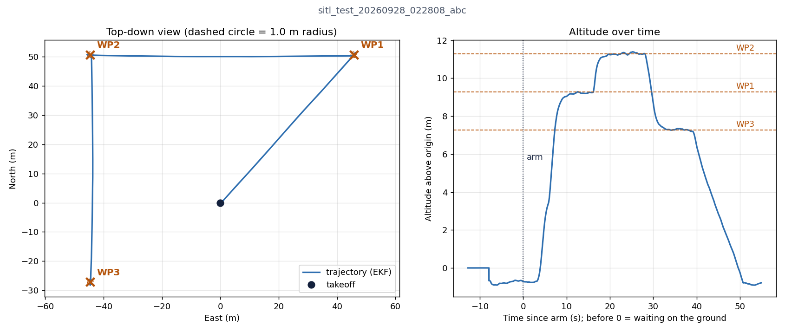

# ros2_ws — Role 1: Flight Control & Navigation

ROS 2 workspace for **Role 1** of the UAV team project (outdoor GPS waypoint navigation + obstacle avoidance on a ModalAI Starling 2 Max: VOXL 2, PX4, uBlox M10).

Role 1 delivers a ROS 2 node that makes PX4 fly to GPS coordinates: it reads GPS, converts target lat/lon to the local frame, streams position setpoints, switches to **Offboard**, and accepts each waypoint once the drone is within a radius. Everything goes over **MAVLink via MAVROS**, and is validated in PX4 SITL + Gazebo.

```
 gps_goto (this repo) ──ROS 2──► MAVROS ──MAVLink/UDP──► [mavlink-router / voxl-mavlink-server] ──► PX4
        ▲                           │
        └── /mavros/state, local_position, global_position, gpsstatus, gp_origin
```

## Status (2026-10-26)

| Item | Status |
|---|---|
| Fly to one GPS coordinate over MAVLink (SITL) | Done: error after hold ~0.3 m |
| Multiple waypoints A → B → C | Done |
| Milestone 1 (arm → takeoff → hover → move → land, 5 consecutive runs) | **5/5 passed** |
| Failsafe tests: node killed, pilot takeover, GPS loss | Done, all land safely |
| Through a MAVLink router (`mavlink-router`, stands in for `voxl-mavlink-server`) | Done |
| ROS 2 Foxy + MAVROS 2.4.0 (as on VOXL 2), in Docker | Done: unit tests 21/21, flights 1 WP / A→B→C / GPS loss / NTUT. Two Foxy-only bugs fixed ([docs/FOXY_DOCKER.md](docs/FOXY_DOCKER.md#5-foxy-problems-found-and-fixed)) |
| Mission on the NTUT East Dorm field (SITL home moved to Taipei) | Done: error after hold 0.11–0.30 m; 0.75–1.86 m with 3 m/s wind |
| Waypoints from the terminal: GPS or offsets from takeoff (`waypoint_frame:=offset`) | GPS override flown in SITL; offsets unit-tested, not yet flown |
| Wind | Tried; wind model is not calibrated (unusable from ~5 m/s) |
| On the real drone | Not yet (weather). Hand-off: [docs/DEPLOY_VOXL2.md](docs/DEPLOY_VOXL2.md), plan: [docs/FIELD_TEST_PLAN.md](docs/FIELD_TEST_PLAN.md) |

Details and plots per flight: [`results/README.md`](results/README.md).



## Layout

```
ros2_ws/
├── src/
│   ├── uav_nav/                         Role 1 package: gps_goto node (MAVROS, Offboard, GPS → local, waypoints)
│   │   ├── uav_nav/gps_goto.py          main node + state machine
│   │   ├── uav_nav/geo.py               GPS ↔ NED (port of PX4 geo.cpp), ECEF → WGS84
│   │   ├── config/gps_goto.yaml         1 waypoint (NTUT field)
│   │   ├── config/gps_goto_ntut.yaml    3 waypoints on the NTUT East Dorm field (Taipei)
│   │   ├── config/mavlink-router-sitl.conf   router: PX4 → MAVROS + GCS (like voxl-mavlink-server)
│   │   ├── launch/gps_goto.launch.py    starts MAVROS (+ router) + gps_goto; waypoints can be set here
│   │   ├── scripts/sitl_test.sh         automated headless SITL test (same steps as docs/MANUAL_RUN.md)
│   │   ├── scripts/plot_flight.py       plot trajectory from flight.ulg
│   │   └── test/                        unit tests: coordinate conversion + state machine (no SITL needed)
│   └── uav_practice/                    self-study: talker/listener, QoS experiment
├── sim/                                 x500 model with wind enabled + windy world
├── docker/foxy/                         ROS 2 Foxy image (like VOXL 2) + unit tests in it
├── docs/                                MANUAL_RUN, FOXY_DOCKER, DEPLOY_VOXL2 (hand-off), FIELD_TEST_PLAN
└── results/                             report1_2026-09-28/, report2_2026-10-26/, runs/ (new runs, not in git)
```

## Prerequisites

Tested on Ubuntu 22.04 with:

| Software | Version | Notes |
|---|---|---|
| ROS 2 | Humble | target on the drone is Foxy (see `docker/foxy/`) |
| PX4-Autopilot | v1.14.0 | SITL with Gazebo (`gz_x500`) |
| MAVROS | 2.15.1 | built from source (no `ros-humble-mavros` binary was available); needs GeographicLib datasets |
| mavlink-router | v4 | only for `router:=true` |
| QGroundControl | 5.0.8 | optional, map and mode display |
| Python | `pyulog`, `matplotlib` | only for `plot_flight.py` |
| Docker | 29.1 (`docker.io`) | only for the Foxy tests (`docker/foxy/`) |

The docs and `sitl_test.sh` assume this layout (`PX4_DIR=...` overrides the PX4 path):

```
~/coding/tools/PX4-Autopilot                           PX4 source + SITL build
~/coding/tools/mavros_ws/install/setup.bash            MAVROS (sourced in ~/.bashrc)
~/coding/tools/mavlink-router/install/bin/mavlink-routerd
~/coding/ros2_ws                                       this repo
```

## Quick start

Step by step, every command explained: **[docs/MANUAL_RUN.md](docs/MANUAL_RUN.md)**. In short:

```bash
cd ~/coding/ros2_ws
source /opt/ros/humble/setup.bash
source ~/coding/tools/mavros_ws/install/setup.bash
colcon build --symlink-install
source install/setup.bash                 # in every new terminal

# Once: PX4 SITL home -> NTUT field. In PX4's pxh> shell, then restart PX4 (MANUAL_RUN.md §2):
#   param set SIM_GZ_HOME_LAT 25.042486 / param set SIM_GZ_HOME_LON 121.537627 / param set SIM_GZ_HOME_ALT 10

(cd ~/coding/tools/PX4-Autopilot && make px4_sitl gz_x500)                  # T1: PX4 + Gazebo
ros2 launch uav_nav gps_goto.launch.py config:=gps_goto_ntut.yaml           # T2: WP1 → WP2 → WP3

# Waypoints from the terminal instead of a file
ros2 launch uav_nav gps_goto.launch.py waypoints:="[25.042224, 121.537790, 8.0]"            # GPS
ros2 launch uav_nav gps_goto.launch.py waypoint_frame:=offset waypoints:="[10, 0, 5]"       # 10 m North, 5 m up
```

Automated re-check after a code change (headless, ~1 min per run, output in `results/runs/`):

```bash
colcon test --packages-select uav_nav && colcon test-result
bash src/uav_nav/scripts/sitl_test.sh config:=gps_goto_ntut.yaml
SCENARIO=gps_loss bash src/uav_nav/scripts/sitl_test.sh                       # kill_node | mode_switch | gps_loss
WIND="-3 0" bash src/uav_nav/scripts/sitl_test.sh                             # air velocity East North, m/s
bash docker/foxy/foxy_test.sh && FOXY=1 bash src/uav_nav/scripts/sitl_test.sh  # Foxy, like the drone
```

`sitl_test.sh` starts and stops its own PX4: do not run it while you have PX4 open by hand.

## Environment

No Python virtualenv is used: ROS 2 ships `rclpy` and the message packages for the system Python.

| Source | Installed with | Examples |
|---|---|---|
| `/opt/ros/humble` | `apt` / `rosdep install --from-paths src --ignore-src -y` | rclpy, geographic_msgs |
| `~/coding/tools/mavros_ws` | MAVROS 2.15.1 built from source with colcon | mavros, mavros_msgs |
| `~/.local` (pip `--user`) | only for plotting | pyulog, matplotlib (`numpy<2`: numpy 2 breaks ROS' cv_bridge) |

All ROS dependencies of `uav_nav` are declared in `src/uav_nav/package.xml`, so `rosdep` installs them.
For a different ROS distro (Foxy, as on the drone) use the Docker image in `docker/foxy/`.

If `mavros` is not found: make sure `~/coding/tools/mavros_ws/install/setup.bash` is sourced, open a new terminal and rebuild.

## gps_goto node

**State machine** (20 Hz):

```
WAIT_READY → PRE_STREAM → ENGAGE → TAKEOFF → GOTO → HOLD → (GOTO …) → LANDING → DONE
     │                      │         │        │                          (FINAL_HOLD if land_at_end=false)
     └── waypoint beyond max_wp_distance / max_alt → ABORT (never arms)
                            │         └────────┴── GPS degraded / drift / timeout → LANDING
                            └── timeout while armed → DISARM → ABORT
 any flying state: lost Offboard (pilot takeover / PX4 failsafe) → ABORT, PX4 takes over
```

- **WAIT_READY**: MAVROS connected, pose + GPS received, 3D fix with horizontal accuracy ≤ `max_eph`. Requests PX4's EKF origin (`gp_origin`) and waits up to 5 s for it; falls back to the current position otherwise. Then converts the waypoints and checks `max_wp_distance` / `max_alt`; on failure it goes to ABORT without arming.
- **PRE_STREAM**: streams setpoints for 1 s (PX4 only enters Offboard once setpoints are flowing).
- **ENGAGE**: requests `OFFBOARD` then arm, retrying every second for up to 10 s.
- **GOTO / HOLD**: a waypoint is reached when within `acceptance_radius` horizontally and `acceptance_alt` vertically; the node then holds for `hold_time` and logs the GPS error.
- Waypoints are converted with the same azimuthal-equidistant projection as PX4 (`geo.py`), anchored at the EKF origin, so targets match PX4's local frame exactly. The node works in MAVROS ENU (x=East, y=North, z=Up).

**Parameters** (`config/*.yaml`):

| Parameter | Default | Meaning |
|---|---|---|
| `waypoints` | `[25.042833, 121.537612, 10.0]` (NTUT field) | flat list `[lat, lon, alt_rel, …]`, `alt_rel` in m above the takeoff point |
| `takeoff_alt` | 5.0 | m, climb before heading to WP1 |
| `acceptance_radius` | 1.0 | m, horizontal |
| `acceptance_alt` | 1.0 | m, vertical |
| `hold_time` | 5.0 | s held at each waypoint |
| `wp_timeout` | 90.0 | s max per leg (and for takeoff) → land |
| `max_eph` | 3.0 | m, do not fly / land if GPS horizontal accuracy is worse |
| `max_drift` | 3.0 | m, horizontal drift during takeoff → land |
| `waypoint_frame` | gps | `gps`: waypoints are `[lat, lon, alt_rel]`; `offset`: `[north_m, east_m, alt_rel]` from the takeoff point |
| `land_at_end` | true | land after the last waypoint, otherwise hold in Offboard |
| `max_wp_distance` | 500.0 | m, checked before arming: any waypoint farther from the takeoff point → ABORT (never arms) |
| `max_alt` | 50.0 | m, checked before arming: any `alt_rel` higher → ABORT |

**Launch arguments**: `config` (file in `config/`), `waypoints` and `waypoint_frame` (override the config file), `router` (`true` = go through mavlink-router), `fcu_url` (empty = chosen from `router`), `gcs_url`, `start_mavros` (`false` if MAVROS is already running), `router_bin`. When `gps_goto` exits, the whole launch (MAVROS, router) shuts down.

**Ports in SITL**: PX4 sends onboard MAVLink to UDP 14540. With `router:=false` MAVROS binds 14540 directly; with `router:=true` `mavlink-routerd` listens on 14540 and forwards to MAVROS (14640) and a second GCS (14551). QGC gets PX4 directly on 14550.

## Notes

- `GPSRAW.eph` is HDOP × 100, not meters; the node uses `h_acc` (mm) for GPS accuracy.
- PX4 SITL saves parameters to disk (`SIM_GPS_USED`, `SIM_GZ_HOME_*`, ...). After a GPS-loss test, set `SIM_GPS_USED 10` again (`sitl_test.sh` does it on startup).
- MAVROS 2.4.0 (Foxy) publishes `gp_origin` as ECEF metres and ships ROS 1 launch files; the node and launch file handle both versions ([details](docs/FOXY_DOCKER.md#5-foxy-problems-found-and-fixed)).
- The launch file starts `mavros_node` directly (not MAVROS' `px4.launch`) for the same reason.
- `flight.ulg` files are excluded from git (≈300 MB); regenerate by re-running the tests.
